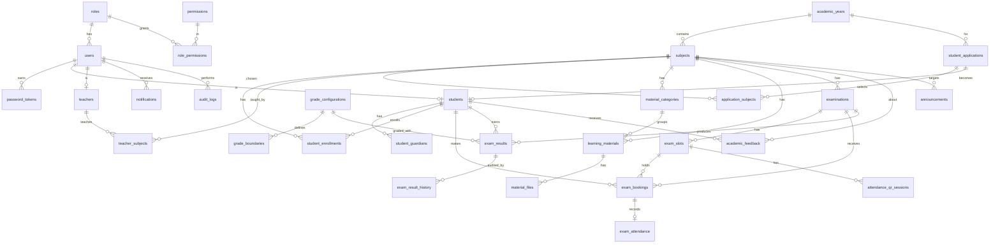

# Architecture (Phase 1)

## Stack
| Layer | Choice |
|---|---|
| Backend | Java 21, Spring Boot 3, Spring Security (session cookie + CSRF), Spring Data JPA, Flyway, springdoc-openapi |
| Database | MySQL 8 (InnoDB, utf8mb4) |
| Frontend | Next.js (React, TypeScript), Tailwind, Recharts, TanStack Query |
| Files | Local disk behind a `StorageService` interface (swap for S3 later) |
| Other | JavaMail + `email_outbox`, OpenPDF, Apache POI, ZXing (QR) |

## Scope decisions
- Exams are **physical sittings**. The app handles scheduling, booking, attendance, staff-entered marks, results and progress. No online answering, so no answer/submission tables.
- Academic year is never stored on students, exams or materials. It is derived via `subject -> academic_year`. Enrollment is `student -> subject`, so a new year adds rows and never overwrites old ones.
- Assignments are built last and added by a later migration.
- Parents have no login; guardian contacts live in `student_guardians` and the application.

## Key rules and where they are enforced
| Rule | Enforcement |
|---|---|
| Max 20 per slot | `CHECK (capacity BETWEEN 1 AND 20)`; atomic `UPDATE exam_slots SET booked_count = booked_count+1 WHERE ... booked_count < capacity` in the booking transaction; `CHECK (booked_count <= capacity)`; drift view `v_slot_booking_drift` |
| Slot belongs to booking's exam; attendance matches booking | composite foreign keys (see `docs/SCHEMA_REVIEW.md`) |
| One booking per student per exam | unique `(examination_id, student_id, active_key)`; cancelled rows kept as history |
| Student must be enrolled in exam's subject | `EnrollmentGuard` service, reused by resources, exams, bookings, announcements, results |
| Students can't cancel/change bookings | no student endpoint exists; admin-only endpoints |
| No duplicate attendance | unique `exam_attendance.booking_id` |
| Duplicate applications | unique `(academic_year_id, open_email_key)`; rejected applications don't block reapplying |
| Student ID `2027STU001` | atomic `INSERT ... ON DUPLICATE KEY UPDATE` on `student_id_sequences` inside the approval transaction |
| Published result edits | row to `exam_result_history` + `audit_logs` |
| Teacher scope | `teacher_subjects` checked on every teacher endpoint |
| Private files | random UUID `stored_name`; served only by an authorized streaming endpoint |
| QR attendance | HMAC token with a key derived from `QR_MASTER_KEY` (env) + per-session salt, so no secret is stored in the DB; short expiry; student logged in with a confirmed booking for that slot |

## ERD

Full DDL: `backend/src/main/resources/db/migration/V1__core_schema.sql`.

## Folder structure
```
learningmanagsystem/
  docs/                      ARCHITECTURE.md, API.md, CHECKLIST.md
  backend/
    pom.xml
    src/main/java/lk/academy/lms/
      config/ security/ common/ (exceptions, ApiResponse, audit)
      auth/ user/ student/ application/ teacher/ academicyear/ subject/
      enrollment/ material/ exam/ slot/ booking/ attendance/
      result/ grade/ progress/ feedback/ notification/ announcement/ report/
    src/main/resources/ application.yml, db/migration/
    src/test/java/...
  frontend/                  Next.js app (app router): (auth) (student) (teacher) (admin)
  docker-compose.yml         mysql + backend + frontend
  .env.example
```
Each backend package holds `Controller`, `Service`, `Repository`, `Entity`, `dto`.

## Phases
1 Planning (this) | 2 Backend foundation + auth/RBAC | 3 Core management | 4 Materials | 5 Exams, slots, booking | 6 Attendance + results | 7 Progress + feedback | 8 Notifications + reports | 9 Frontend | 10 Testing + deployment | then Assignments.
